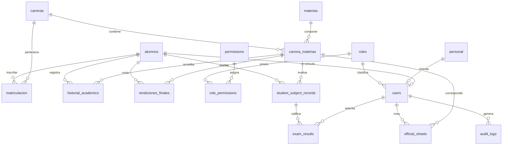

# Documentación Técnica: Unificación de Base de Datos y Módulo de Usuarios / Validación de Notas

**Proyecto:** Sistema de Gestión Académica y Preceptoría (ISFT 182)  
**Base de Datos Oficial Única:** MySQL (`clementina`)  
**Archivo de Definición DDL:** [`esquema_normalizado (2).sql`](file:///c:/MyProjects/ProyectoPreceptoria/esquema_normalizado%20(2).sql)  
**Fecha de Actualización:** Noviembre 2026  

---

## 1. Resumen de la Integración

El sistema utilizaba originalmente una base de datos relacional MySQL para alumnos, inscripciones, historial académico y finales, mientras que el módulo de **Usuarios y Validación de Notas** operaba de forma aislada sobre un archivo SQLite (`institution.sqlite`).

Para consolidar **una única fuente de la verdad**, se unificó la arquitectura en **MySQL (`clementina`)**:
1. Se descarta el motor SQLite local.
2. Se incorporó una sección formal en [`esquema_normalizado (2).sql`](file:///c:/MyProjects/ProyectoPreceptoria/esquema_normalizado%20(2).sql) (Sección 6) con las tablas requeridas para autenticación por roles (RBAC), auditoría inmutable, actas volantes y motor del semáforo.
3. Todas las tablas nuevas se encuentran normalizadas y vinculadas mediante restricciones de clave foránea (`FOREIGN KEY`) a las tablas troncales de MySQL (`alumnos`, `carreras`, `carrera_materias`, `personal`).

---

## 2. Resumen Comparativo de Tablas

### A. Tablas Originales del Esquema Institucional
* **Catálogos:** `tipos_documento`, `tipos_personal`, `paises`, `provincias`, `partidos`, `localidades`, `codigos_postales`, `codigos_area_telefonicos`, `turnos`, `sedes`.
* **Personas:** `alumnos`, `domicilios_alumno`, `personal`, `aspirantes`.
* **Académico:** `carreras`, `materias`, `carrera_materias`, `materia_horarios`, `correlatividades`, `carrera_sede_turno`.
* **Transaccional:** `inscripciones`, `matriculacion`, `matriculacion_detalle`, `historial_academico`, `rendiciones_finales`.
* **Parámetros:** `parametros_generales`, `parametros_mesas`, `parametros_inscripcion`, `parametros_matriculacion`, `aspirantes_parametros`.

---

### B. Tablas Extras Agregadas respecto a la Original

Para permitir la operación del módulo de Usuarios, Roles, Auditoría, Validación de Notas e Inscripción a Finales (Módulo D) en la misma base, se agregaron las siguientes **9 tablas**:

| # | Tabla Agregada | Propósito / Funcionalidad | Vinculación con Esquema Original |
| :--- | :--- | :--- | :--- |
| 1 | **`roles`** | Catálogo de roles de seguridad del sistema (ADMINISTRADOR, DOCENTE, PRECEPTOR, ALUMNO, CONSULTA, etc.). | Base para el control de acceso de todos los usuarios. |
| 2 | **`permissions`** | Catálogo granular de privilegios (ej. `USERS_VIEW`, `GRADES_VIEW`, `EXAMS_CREATE`). | Modularidad y asignación de capacidades. |
| 3 | **`role_permissions`** | Tabla relacional muchos a muchos entre roles y permisos. | FK a `roles` y `permissions` con borrado en cascada. |
| 4 | **`users`** | Cuentas de acceso al sistema con contraseñas encriptadas con Bcrypt. | **FK opcional a `personal(id_personal)`** y **FK opcional a `alumnos(id_alumno)`**. |
| 5 | **`audit_logs`** | Bitácora inmutable de auditoría institucional (quién modificó notas, usuarios o actas, IP, timestamp y snapshot JSON). | FK a `users(id)`. |
| 6 | **`student_subject_records`** | Seguimiento de cursada y estado en tiempo real del **Semáforo** (Verde, Amarillo, Rojo, Gris) por estudiante y materia. | **FK a `alumnos(id_alumno)`** y **FK a `carrera_materias(id_carrera, id_materia)`**. |
| 7 | **`exam_results`** | Registro de evaluaciones parciales, recuperatorios y finales de cursada. | FK a `student_subject_records(id)` y FK a `users(id)` (docente que califica). |
| 8 | **`official_sheets`** | Planillas y Actas Volantes digitales de cursada y Mesas de Examen con control de visibilidad (RLS). | **FK a `carrera_materias(id_carrera, id_materia)`** y FK a `users(id)` (creador del acta). |
| 9 | **`auditoria_inscripciones_finales`** | Bitácora histórica de altas, reasignaciones y bajas lógicas de inscripciones a exámenes finales (Módulo D). | **FK a `rendiciones_finales(id_rendicion)`** con borrado en cascada. |

### C. Columnas Adicionales Incorporadas a Tablas Existentes (Integración Módulo D)
* **`carrera_materias`**:
  * `exceptuada_libre TINYINT(1) DEFAULT 0`: Indica si la materia está exceptuada de condición Libre por normativa (Prácticas Profesionalizantes, Talleres, Seminarios, Laboratorios, Ateneos).
  * `tipo_espacio VARCHAR(45) DEFAULT 'Asignatura'`: Clasificación normativa del espacio curricular.
* **`rendiciones_finales`**:
  * `estado`: Ampliado el `ENUM` para incluir `'BAJA'` (baja lógica sin borrado físico).
  * `reasignada TINYINT(1) DEFAULT 0`: Marca si la inscripción fue reasignada de turno/llamado/modalidad.
  * `fecha_baja DATETIME DEFAULT NULL`: Fecha y hora en que se registró la baja lógica.

---

## 3. Especificación Detallada de las Tablas Agregadas

### 3.1. `roles`
* **Columnas:**
  * `id INT AUTO_INCREMENT PRIMARY KEY`
  * `name VARCHAR(50) NOT NULL UNIQUE`: Nombre normalizado del rol (`ADMINISTRADOR`, `PRECEPTOR`, `DOCENTE`, etc.).
  * `description VARCHAR(255)`: Alcance institucional del rol.
  * `is_active TINYINT(1) DEFAULT 1`: Estado habilitado/deshabilitado.
  * `created_at DATETIME DEFAULT CURRENT_TIMESTAMP`

### 3.2. `permissions`
* **Columnas:**
  * `id INT AUTO_INCREMENT PRIMARY KEY`
  * `code VARCHAR(50) NOT NULL UNIQUE`: Código en mayúsculas (ej. `AUTH_LOGIN`, `GRADES_VIEW`, `USERS_EDIT`).
  * `name VARCHAR(100) NOT NULL`: Nombre descriptivo legible.
  * `description VARCHAR(255)`: Detalle de qué acción autoriza.
  * `module VARCHAR(50) NOT NULL`: Módulo funcional (`AUTH`, `USERS`, `ROLES`, `ACADEMIC`, `AUDIT`).

### 3.3. `role_permissions`
* **Columnas:**
  * `role_id INT NOT NULL`
  * `permission_id INT NOT NULL`
  * `PRIMARY KEY (role_id, permission_id)`
  * `FOREIGN KEY (role_id) REFERENCES roles(id) ON DELETE CASCADE`
  * `FOREIGN KEY (permission_id) REFERENCES permissions(id) ON DELETE CASCADE`

### 3.4. `users`
* **Columnas:**
  * `id INT AUTO_INCREMENT PRIMARY KEY`
  * `email VARCHAR(255) NOT NULL UNIQUE`: Correo electrónico institucional (login).
  * `password_hash VARCHAR(255) NOT NULL`: Hash seguro (Bcrypt con salt rounds $\ge 10$).
  * `first_name VARCHAR(100) NOT NULL`: Nombre.
  * `last_name VARCHAR(100) NOT NULL`: Apellido.
  * `role_id INT NOT NULL`: FK a `roles(id)`.
  * `id_personal INT DEFAULT NULL`: FK opcional a tabla `personal(id_personal)`.
  * `id_alumno BIGINT DEFAULT NULL`: FK opcional a tabla `alumnos(id_alumno)`.
  * `is_active TINYINT(1) DEFAULT 1`
  * `created_at DATETIME DEFAULT CURRENT_TIMESTAMP`
  * `updated_at DATETIME DEFAULT CURRENT_TIMESTAMP ON UPDATE CURRENT_TIMESTAMP`

### 3.5. `audit_logs`
* **Columnas:**
  * `id BIGINT AUTO_INCREMENT PRIMARY KEY`
  * `user_id INT DEFAULT NULL`: FK a `users(id)` con `ON DELETE SET NULL`.
  * `user_email VARCHAR(255)`
  * `user_name VARCHAR(200)`
  * `action_type VARCHAR(50) NOT NULL`: Tipo de evento (`LOGIN`, `GRADE_UPDATE`, `SHEET_CREATE`, etc.).
  * `entity VARCHAR(50) NOT NULL`: Entidad afectada (`users`, `grades`, `sheets`).
  * `entity_id VARCHAR(50)`: Identificador del registro modificado.
  * `previous_values JSON DEFAULT NULL`: Snapshot del estado previo.
  * `new_values JSON DEFAULT NULL`: Snapshot del nuevo estado.
  * `ip_address VARCHAR(45)`
  * `created_at DATETIME DEFAULT CURRENT_TIMESTAMP`

### 3.6. `student_subject_records`
* **Columnas:**
  * `id BIGINT AUTO_INCREMENT PRIMARY KEY`
  * `student_id BIGINT NOT NULL`: FK a `alumnos(id_alumno)`.
  * `id_carrera INT NOT NULL`: FK combinada a `carrera_materias(id_carrera, id_materia)`.
  * `id_materia INT NOT NULL`: FK combinada a `carrera_materias(id_carrera, id_materia)`.
  * `academic_year INT NOT NULL`: Ciclo lectivo (ej. 2025, 2026).
  * `cursada_status VARCHAR(30) NOT NULL DEFAULT 'EN_CURSO'`: (`EN_CURSO`, `REGULAR`, `APROBADA_PROMOCION`, `APROBADA_FINAL`, `DESAPROBADA_FINAL`, `LIBRE`).
  * `cursada_grade DECIMAL(4,2) DEFAULT NULL`: Promedio o calificación de cursada.
  * `final_exam_grade DECIMAL(4,2) DEFAULT NULL`: Nota de examen final acreditada.
  * `traffic_light_color ENUM('GREEN', 'YELLOW', 'ORANGE', 'RED', 'GRAY') NOT NULL DEFAULT 'GRAY'`.
  * `traffic_light_label VARCHAR(100) NOT NULL`: Texto legible (ej. "Aprobada por Promoción", "Final Desaprobado").
  * `traffic_light_reason TEXT NOT NULL`: Explicación reglamentaria del estado.
  * `sheet_data JSON DEFAULT NULL`: Almacenamiento complementario de observaciones de la planilla.
  * `updated_at DATETIME DEFAULT CURRENT_TIMESTAMP ON UPDATE CURRENT_TIMESTAMP`
  * `UNIQUE KEY uq_student_subject_year (student_id, id_carrera, id_materia, academic_year)`

### 3.7. `exam_results`
* **Columnas:**
  * `id BIGINT AUTO_INCREMENT PRIMARY KEY`
  * `student_subject_id BIGINT NOT NULL`: FK a `student_subject_records(id)` con `ON DELETE CASCADE`.
  * `evaluation_type VARCHAR(30) NOT NULL`: (`PARCIAL_1`, `PARCIAL_2`, `RECUPERATORIO_1`, `RECUPERATORIO_2`, `FINAL`).
  * `grade DECIMAL(4,2) DEFAULT NULL`: Nota (1.00 a 10.00).
  * `is_absent TINYINT(1) DEFAULT 0`: Bandera de ausencia (1 = Ausente).
  * `exam_date DATE NOT NULL`
  * `observations TEXT DEFAULT NULL`
  * `registered_by INT NOT NULL`: FK a `users(id)` (quién asentó la nota).
  * `created_at DATETIME DEFAULT CURRENT_TIMESTAMP`

### 3.8. `official_sheets`
* **Columnas:**
  * `id BIGINT AUTO_INCREMENT PRIMARY KEY`
  * `sheet_type ENUM('MESA_EXAMEN', 'ACTA_VOLANTE') NOT NULL`
  * `user_id_creador INT NOT NULL`: FK a `users(id)`.
  * `id_carrera INT NOT NULL`: FK combinada a `carrera_materias`.
  * `id_materia INT NOT NULL`: FK combinada a `carrera_materias`.
  * `carrera VARCHAR(100) NOT NULL`: Nombre descriptivo redundante para reportes rápidos.
  * `materia VARCHAR(100) NOT NULL`: Nombre descriptivo de la materia.
  * `libro_numero VARCHAR(20) DEFAULT ''`
  * `folio_numero VARCHAR(20) DEFAULT ''`
  * `fecha VARCHAR(20) DEFAULT ''`
  * `docente_titular VARCHAR(100) DEFAULT ''`
  * `docente_suplente VARCHAR(100) DEFAULT ''`
  * `primer_vocal VARCHAR(100) DEFAULT ''`
  * `segundo_vocal VARCHAR(100) DEFAULT ''`
  * `rows_data JSON NOT NULL`: Filas de alumnos con sus notas de parciales/finales.
  * `estado VARCHAR(20) DEFAULT 'Borrador'`: (`Borrador`, `GRIS`, `AMARILLO`, `VERDE`, `ROJO`).
  * `observaciones_admin TEXT DEFAULT NULL`
  * `created_at DATETIME DEFAULT CURRENT_TIMESTAMP`
  * `updated_at DATETIME DEFAULT CURRENT_TIMESTAMP ON UPDATE CURRENT_TIMESTAMP`

---

## 4. Mapeo de Integración y Flujo de Datos

### Reglas de Integración con el Sistema Central:
1. **Validación de Cursada $\rightarrow$ Historial Académico:**
   Cuando en `official_sheets` o en el semáforo se valida una cursada regular (`ORANGE` / Regularizada), se asienta automáticamente `historial_academico.validado_regular = 'T'` y el año correspondiente.
2. **Acreditación Final $\rightarrow$ Rendiciones Finales:**
   Al registrar un examen final aprobado (`GREEN`), se actualiza `rendiciones_finales.nota`, `rendiciones_finales.estado = 'APROBADO'` y `historial_academico.nota`.
3. **Control de 8 Turnos y 3 Aplazos:**
   El módulo de Usuarios y Validación de Notas consulta la tabla oficial `rendiciones_finales` para verificar que el estudiante no exceda el límite reglamentario de fallas.

---

## 5. Modo de Aplicación en MySQL (XAMPP)

Para aplicar este esquema completo en tu base de datos local:

1. Iniciar **Apache** y **MySQL** en XAMPP.
2. Abrir **phpMyAdmin** (`http://localhost/phpmyadmin`) o tu cliente MySQL (HeidiSQL, DBeaver, MySQL Workbench).
3. Seleccionar la base de datos **`clementina`**.
4. Importar o ejecutar el archivo completo:
   [`esquema_normalizado (2).sql`](file:///c:/MyProjects/ProyectoPreceptoria/esquema_normalizado%20(2).sql)
5. Todas las tablas existentes se conservan intactas y las 8 nuevas tablas se crean con sus respectivas claves foráneas y restricciones.

---

## 6. Estado Actual de la Integración (Completada)

### Tareas Completadas:
1. **Esquema Único Actualizado:** Se incorporaron las 8 tablas de la Sección 6 en [`esquema_normalizado (2).sql`](file:///c:/MyProjects/ProyectoPreceptoria/esquema_normalizado%20(2).sql) y se aplicaron en MySQL (`clementina`, 38 tablas activas).
2. **Eliminación Total de SQLite y Datos de Prueba:**
   * Se eliminaron los archivos residuales `institution.sqlite`, `institution.sqlite-shm` y `institution.sqlite-wal`.
   * Se limpiaron [`backend/src/usuarios-notas/database/initDb.js`](file:///c:/MyProjects/ProyectoPreceptoria/backend/src/usuarios-notas/database/initDb.js) y [`backend/src/usuarios-notas/database/seed.js`](file:///c:/MyProjects/ProyectoPreceptoria/backend/src/usuarios-notas/database/seed.js) para operar exclusivamente sobre MySQL (`clementina`), sin generar alumnos ni materias ficticias.
   * Se eliminaron todos los arreglos de datos de prueba y fallbacks locales en [`frontend/usuarios-notas/js/app.js`](file:///c:/MyProjects/ProyectoPreceptoria/frontend/usuarios-notas/js/app.js) (`FALLBACK_RECORDS`, `FALLBACK_SHEETS`, `FALLBACK_USERS`, `FALLBACK_SUBJECTS`, `FALLBACK_ROLES`, `FALLBACK_LOGS`, `EXACT_CAREERS`, `DEMO_PROFILES`).
3. **Backend 100% Migrado a MySQL (`mysql2/promise`):**
   * [`db.js`](file:///c:/MyProjects/ProyectoPreceptoria/backend/src/usuarios-notas/database/db.js): Pool MySQL con transacciones ACID mediante `AsyncLocalStorage`.
   * [`examService.js`](file:///c:/MyProjects/ProyectoPreceptoria/backend/src/usuarios-notas/services/examService.js): Sincronización automática desde `historial_academico` y `rendiciones_finales` hacia `student_subject_records` y `exam_results`. Consultas de alumnos (`alumnos`), carreras (`carreras`) y materias (`carrera_materias` + `materias`) directamente contra MySQL.
   * [`gradingEngineService.js`](file:///c:/MyProjects/ProyectoPreceptoria/backend/src/usuarios-notas/services/gradingEngineService.js): Recálculo del semáforo con sincronización bidireccional hacia `historial_academico`.
   * [`sheetService.js`](file:///c:/MyProjects/ProyectoPreceptoria/backend/src/usuarios-notas/services/sheetService.js): Carreras, materias y planillas oficiales (`official_sheets`) con resolución de claves foráneas reales `(id_carrera, id_materia)` en MySQL.
   * [`authService.js`](file:///c:/MyProjects/ProyectoPreceptoria/backend/src/usuarios-notas/services/authService.js), [`userService.js`](file:///c:/MyProjects/ProyectoPreceptoria/backend/src/usuarios-notas/services/userService.js), [`roleService.js`](file:///c:/MyProjects/ProyectoPreceptoria/backend/src/usuarios-notas/services/roleService.js) y [`auditService.js`](file:///c:/MyProjects/ProyectoPreceptoria/backend/src/usuarios-notas/services/auditService.js): Migrados a consultas asíncronas compatibles con MySQL/MariaDB (`CONCAT`, `NOW()`, JSON nativo).
4. **Sanitización Estética Global:**
   * Se eliminaron todos los emojis decorativos del proyecto, preservando exclusivamente los indicadores del semáforo (🟢, 🟡, 🟠, 🔴, ⚪, 🔵).

### Nota sobre Módulo C (`usuarios-notas`), Módulo E y Módulo D (`InscripcionFinales`):
* **Módulo C (`usuarios-notas` — Usuarios y Validación de Notas):** Refactorizado estrictamente según los requerimientos oficiales del cliente (`recursos/REQUERIMIENTOS_MODULOS.txt`):
  * **Semáforo oficial de 3 colores sobre `historial_academico`:** 🟢 **Verde** (`validado_examen = 'T'`, verificado con final aprobado / promoción), 🟠 **Naranja** (`validado_regular = 'T'` y `validado_examen != 'T'`, regularizada y verificada con preceptoría) y 🔴 **Rojo** (sin verificar).
  * **Corrección del error "Promoción -> No definido":** Mapeo explícito de `historial_academico.tipo_alumno` (`'P'` = Promoción, `'R'` = Regular, `'L'` = Libre, `'E'` = Equivalencia, `'X'` = Sin definir a corregir), con alerta visual y corrección directa.
  * **Endpoints alineados al contrato:** `PATCH /api/v1/resultados/:id/validacion`, `PATCH /api/v1/academic/validacion`, `GET /api/v1/academic/records`, `/api/v1/usuarios`, `/api/v1/roles` y `/api/v1/audit-logs`.
  * **Auditoría obligatoria por usuario:** Cada validación de semáforo o corrección de tipo de examen registra el usuario, acción (`GRADE_VALIDATED` / `TIPO_EXAMEN_CORREGIDO`), valores anteriores y nuevos en `audit_logs`.
  * **Limpieza de alcance:** Se removieron pestañas fuera de alcance (actas volantes Excel, motor de parciales P1/P2/Rec y guía JWT), dejando una interfaz simple de 4 pestañas con ayudas claras por campo.
* **Módulo E (`frontend/modulo-e/`):** Se eliminaron completamente `MOCK_ALUMNOS`, `MOCK_CARRERAS`, `MATERIAS_STORE` y `mockInscripcionesBase`; ahora opera 100% sobre MySQL (`clementina`) con CRUD real de carreras, materias y horarios.
* **Módulo D (`InscripcionFinales`):** Se detectó superposición funcional con `sistema.html` (Control de Finales), por lo que se adaptaron e integraron sus 4 funcionalidades diferenciales (Baja lógica, Reasignación con auditoría, Excepción normativa Libre y Exportación a Excel `.xls`) directamente al stack unificado (**MySQL + Express + Vanilla JS**), eliminando la carpeta duplicada de ~1.6 GB (`Prisma` + `React` + `node_modules`).

### Verificación con XAMPP Activo:
1. Iniciar **MySQL** en XAMPP (puerto `3306`).
2. Iniciar el backend (`cd backend && npm run dev`) y el frontend (`cd frontend && npm run dev`).
3. Abrir `http://localhost:5173/usuarios-notas/index.html` y verificar que la tabla de calificaciones muestre los alumnos, carreras y materias reales de `clementina`.

